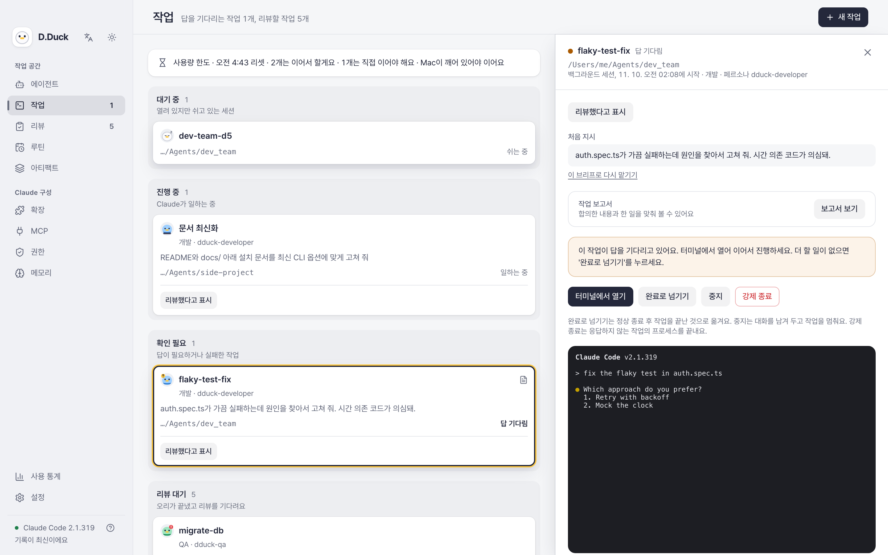
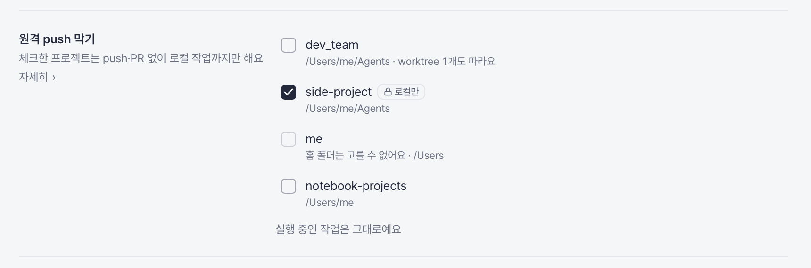
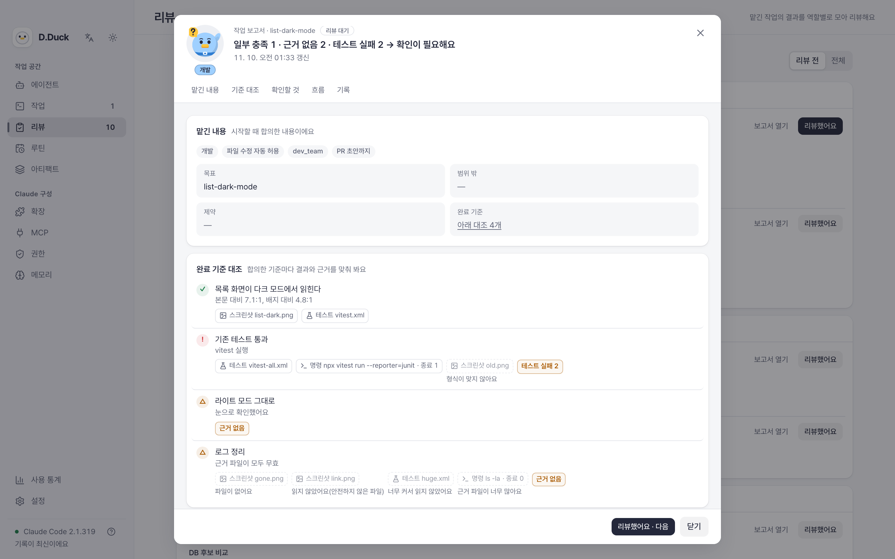
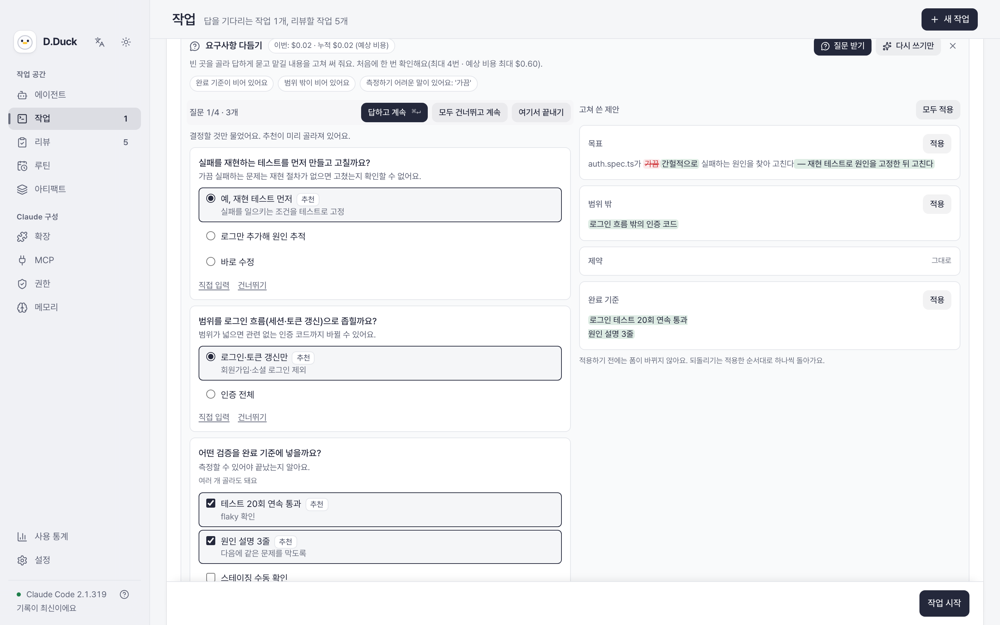
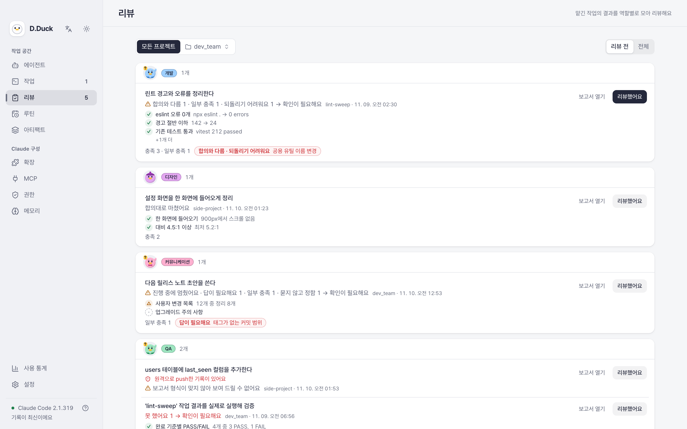

<!-- markdownlint-disable MD033 MD041 -->
<div align="center">


# D.Duck

### Claude Code 에이전트 팀과 테크 리드처럼 일합니다.

Claude Code가 보이지 않는 곳에 쌓아 두는 것을 보이게 하고, 더 많이 맡기면서도 품질은 놓치지 않으며, 인지적 공수는 꼭 필요한 곳에만 씁니다:
가시성, 강제되는 가드레일, 근거로 하는 리뷰.

[English](README.md) · [설치](#설치) · [소스로 빌드](#소스로-빌드)



</div>

---

## 하는 일

맡기는 일이 많아질수록 가장 귀한 것은 사람의 주의입니다. 대부분의 도구는 세션 하나를 꼼꼼히 지켜보게 돕습니다. D.Duck은 그보다 한 단계 위에서, 테크 리드처럼 일하게 해 줍니다. 방향을 정하고, 가드레일을 긋고, 나만 내릴 수 있는 결정을 온전히 내리는 동안 실행은 에이전트가 맡습니다. 위임 수준은 높이고 품질 기준은 낮추지 않습니다. Claude Code 에이전트를 여러 개 동시에 돌리면 여러 문제가 생기는데, D.Duck은 각각에 답합니다.

| 겪는 문제 | D.Duck 기능 |
|---|---|
| Claude Code는 많은 것을 보이지 않는 곳에 둡니다. 메모리, 여러 범위에 흩어진 설정, 설치해 두고 잊은 스킬과 플러그인, 끝난 작업이 남긴 폴더. 보이지 않으니 관리할 수 없습니다. | **가시성 먼저:** 읽고 고치고 끌 수 있는 메모리, 실제로 적용되는 권한, 마지막 사용 시점이 보이는 스킬·플러그인·MCP 서버, 세션별 사용량, 끝난 작업을 치우는 정리 단계 |
| 메모리와 규칙 파일로 통제하고 있고 에이전트도 대체로 따릅니다. 하지만 그 통제가 실제로 어디에 적용되는지 보이지 않고, 드물게 따르지 않는 경우를 막을 장치가 없습니다. 더 많이 맡기려면 신뢰가 중요한 작업에는 그래도 지켜지는 선이 필요합니다. | **프롬프트 밖에서 강제되는 가드레일:** 기본은 초안 PR, 신뢰가 중요한 저장소는 "원격 push 막기", 엄격한 작업 유형은 위험한 모드 차단 |
| 설정이 여러 파일에 나뉘어 있어서 어떤 권한이 실제로 적용되는지 알 수 없습니다. | **실효 권한:** 모든 범위를 합친 결과를 규칙마다 함께 표시 |
| 모호하게 맡기면 엉뚱한 결과가 돌아오고, 리뷰할 때가 되어서야 알게 됩니다. | **구조화된 브리프**(목표, 범위 밖, 제약, 완료 기준)와 시작 전 Claude의 되묻기 |
| "완료, 테스트 통과"만으로는 알 수 있는 것이 적어서 결국 전부 다시 확인합니다. | **근거가 담긴 보고서:** 완료 기준마다 충족, 부분 충족, 미충족과 스크린샷, 테스트 리포트, 명령 출력 |
| 코드를 쓴 세션은 그 코드의 가장 나쁜 리뷰어입니다. | **새로운 눈의 리뷰:** 끝난 작업을 대화를 본 적 없는 새 QA·리뷰 세션에 전달 |
| 에이전트가 내가 리뷰하는 속도보다 빨리 끝내서, 리뷰가 병목이 됩니다. | 하루 **리뷰 용량**, 그리고 끝난 작업을 역할별로 묶는 **리뷰 탭** |
| 세션이 많이 열려 있으면 터미널 탭을 하나씩 열어 대기나 실패를 찾아야 합니다. | **하나의 작업 보드:** 내 답이 필요한 작업이 맨 위, 터미널 실시간 미리보기, 에이전트가 기다릴 때 알림 |
| 스킬, MCP 서버, 플러그인, 메모리가 여러 파일에 흩어져 있습니다. | **확장, MCP, 권한, 메모리 탭:** JSON 없이 보고, 만들고, 고치고, 지웁니다 |
| 잘 되는 방식이 검증되어도 매번 손으로 다시 합니다. | **잘 되는 것 키우기:** 스킬이나 명령으로 저장하고, 스킬을 워크플로로 엮고(Claude Code가 실제로 읽을 수 있는지 검사), 루틴으로 일정에 맞춰 실행 |
| 제가 모르는 사이에 굳은 나쁜 습관을 알아채지 못합니다. 작은 일에 비싼 모델을 쓰거나, 실패하는 명령을 반복하거나, 낡은 설정을 그대로 둡니다. | **사용 개선 분석:** 내 사용 기록에서 비용을 늘리거나 성공률을 떨어뜨리는 패턴을 찾아 이유를 설명하고, 권고를 바로 맡길 수 있는 작업으로 만듭니다 |

아래 다섯 묶음에서 이것들이 어떻게 맞물리는지 설명합니다.

### 1. 부탁이 아니라 강제되는 가드레일

**문제:** 메모리와 규칙 파일은 이미 에이전트를 잘 이끌고, 대부분의 작업에는 그걸로 충분합니다. 하지만 지시일 뿐 강제는 아니어서, 드물게 따르지 않는 경우를 막지 못합니다. 위임 수준을 높이려면 신뢰가 중요한 작업에는 그때도 지켜지는 선이 필요합니다.

**D.Duck:** 맡긴 일이 어디서 멈추고 나를 기다릴지 직접 정합니다. 그 선은 프롬프트 밖에서 CLI deny 규칙, 도구 실행 전 훅, git 설정으로 강제됩니다.

- **기본 가드레일: 초안 PR.** 에이전트는 작업 브랜치를 push하고 초안 PR을 여는 데까지만 갑니다. 머지는 내 몫입니다.
- **신뢰가 중요한 저장소: 내 컴퓨터 안에 둡니다.** "원격 push 막기"를 켜면 로컬에서 리뷰하기 전에는 아무것도 밖으로 나가지 않습니다.
- **위험한 권한 모드는 막힙니다.** 보안, 배포, QA 작업에서 고를 수 없습니다.

### 2. 근거로 하는 리뷰, 내 시간에 맞춰

**문제:** 에이전트는 내가 읽는 것보다 빨리 일을 끝내고, "완료, 테스트 통과"만으로는 알 수 있는 것이 적습니다. 리뷰가 새로운 병목이 됩니다.

**D.Duck:**

- **맡기기 전 브리프:** 목표, 범위 밖, 제약, 완료 기준을 적습니다. Claude가 먼저 되묻습니다.
- **근거가 담긴 보고서:** 완료 기준마다 충족, 부분 충족, 미충족으로 돌아오며 스크린샷, 테스트 리포트, 명령 출력이 붙습니다. 근거가 없으면 통과도 없습니다.
- **새로운 눈:** 끝난 작업을 원래 대화를 본 적 없는 새 QA·리뷰 세션에 보냅니다.
- **리뷰 용량:** 하루에 제대로 리뷰할 수 있는 변경 수를 정합니다. 넘기면 새 작업을 시작하기 전에 D.Duck이 먼저 확인합니다.

### 3. 숨어 있던 것과 나를 기다리는 일을 보이게

**문제:** Claude Code는 많은 것을 잘 보지 않는 곳에 저장합니다. 모든 세션에 들어가는 메모리, 여러 범위에서 합쳐지는 권한, 설치해 두고 잊은 스킬과 플러그인, 끝난 작업이 남긴 폴더. 게다가 세션이 여러 개 열려 있으면 터미널 탭을 하나씩 열어 대기, 실패, 완료를 확인해야 합니다.

**D.Duck:** 터미널 세션과 D.Duck 작업을 한 보드에 모읍니다. 내 답이 필요한 작업이 맨 위에 오고, 터미널 실시간 미리보기가 있으며, 에이전트가 기다리면 알림이 옵니다. 숨어 있던 것도 꺼냅니다. 메모리는 읽고 고치고 끌 수 있고, *실제로* 적용되는 권한을 보여 주며, 스킬·플러그인·MCP 서버는 마지막 사용 시점과 함께 보여서 쓰지 않는 것을 정리할 수 있습니다. 끝난 작업이 남긴 것은 정리 단계에서 치웁니다. 모두 JSON 없이 고칠 수 있고, 대화 원문은 저장하지 않습니다.

### 4. 잘 되는 것을 스킬·워크플로·루틴으로 키우기

**문제:** 맡기는 일은 좋은 방식을 다시 입력하지 않고 재사용할 때 효과가 납니다. 한 번 잘 먹힌 프롬프트는 채팅 기록에 묻히고, 반복 가능한 형태로 만들려면 확인하기 어려운 파일을 손으로 고쳐야 합니다.

**D.Duck:** 잘 되는 것을 한 단계씩 위로 올립니다.

- **스킬 또는 명령:** 일하는 방식을 스킬이나 슬래시 명령으로 저장합니다. 직접 쓰거나 Claude에게 초안을 맡기거나 링크로 설치합니다.
- **워크플로:** 그 스킬들을 여러 단계의 큰 워크플로로 엮습니다. D.Duck이 Claude Code가 읽는 방식 그대로 워크플로를 검사하므로, Claude Code가 조용히 건너뛸 파일은 저장하기 전에 표시됩니다.
- **루틴:** 워크플로를 내 Mac이나 claude.ai 클라우드 루틴에서 일정에 맞춰 실행하며, 다른 작업과 같은 가드레일이 적용됩니다.

단계마다 맡기는 단위가 커지므로 프롬프트 하나가 아니라 프로세스 전체를 넘기고, 주의는 결정에 남습니다.

### 5. 스스로 못 보는 습관을 찾아 고치기

**문제:** 도구를 잘못 쓰는 방식은 정작 본인이 보지 못합니다. 짧은 일에 무거운 모델을 쓰고, 실패하는 명령을 다시 시도하고, 효과 없는 캐시를 쓰고, CLI가 몇 버전 뒤처져 있어도 오류로는 드러나지 않습니다.

**D.Duck:** 사용 개선 분석이 내 사용 기록을 읽고 비용을 늘리거나 성공률을 떨어뜨리는 패턴을 이유와 출처와 함께 짚습니다. 권고 하나하나를 클릭 한 번으로 작업으로 만들 수 있어서, 고치는 일도 메모로 남지 않고 다른 일처럼 맡겨집니다.

<table>
<tr>
<td width="50%"></td>
<td width="50%"></td>
</tr>
<tr>
<td align="center">가드레일: 신뢰가 중요한 저장소를 로컬에 두기</td>
<td align="center">완료 기준마다 근거가 붙는 보고서</td>
</tr>
<tr>
<td></td>
<td></td>
</tr>
<tr>
<td align="center">시작 전에 Claude가 되묻기</td>
<td align="center">끝난 작업을 역할별로 묶음</td>
</tr>
</table>

## 만든 이유

Claude Code 에이전트 팀에게 실제 일을 맡기면서도 권한 통제를 놓지 않고, 아낀 시간을 결과물 리뷰에 다 쓰지 않기를 바랐습니다. D.Duck은 약 일주일간 이를 고민하고 만든 결과입니다. 로컬 Claude Code 사용을 중심으로 개발했습니다.

**왜 오리인가?** D.Duck은 **Developer Duck**의 줄임말로, [러버덕 디버깅](https://ko.wikipedia.org/wiki/러버덕_디버깅)에서 착안했습니다. 고무 오리에게 문제를 설명하다 보면 답이 보이듯, 에이전트 오리들에게 일을 설명하고 맡깁니다. 다만 이 오리들은 역할이 있고, 대답합니다.

## 전체 기능

| 영역 | 하는 일 |
|---|---|
| **에이전트** | 모든 에이전트(사용자, 프로젝트, 플러그인, 내장)를 오리 카드로 표시하고 작업 중, 내 답 대기, 실패, 휴식 상태를 보여줍니다. 기본 역할 열 가지는 작업 세션에만 주입됩니다. |
| **작업 맡기기** | 폴더와 10가지 작업 유형 중 하나를 고릅니다. 유형마다 역할, 도구, 기본 권한, 생각 깊이가 따릅니다. 팀 규칙은 모든 작업에 붙고 안전 규칙은 잠겨 있습니다. |
| **작업 보드** | 대기 → 진행 중 → 확인 필요 → 리뷰 대기 → 마무리. 터미널 실시간 미리보기를 제공합니다. |
| **리뷰** | 근거가 담긴 보고서, 역할별로 묶은 리뷰 탭, 텍스트 복사와 첨부 저장. |
| **가드레일** | 기본은 초안 PR, 신뢰가 중요한 저장소는 "원격 push 막기", 엄격한 작업 유형은 위험한 모드 차단. |
| **루틴과 아티팩트** | 로컬 또는 claude.ai 클라우드 루틴으로 일정에 맞춰 실행합니다. 세션 곳곳에서 Claude가 만든 아티팩트를 모아 봅니다. |
| **JSON 없이 설정** | 스킬, 명령, 워크플로, 플러그인, MCP 서버, 규칙, 메모리, 실효 권한. 저장 전에 변경 내용을 먼저 보여줍니다. |
| **사용량** | 기간별 비용, 모델, 도구·스킬 호출, 사용량 한도 알림, 권고를 작업으로 만드는 사용 개선 분석. |
| **언어** | 한국어와 영어. 사이드바나 설정에서 바꿉니다. |

## 설계 원칙

| | |
|---|---|
| **로컬 전용** | Claude Code 기록은 이 Mac에서만 읽고, 앱 데이터는 로컬 데이터베이스에 둡니다. 외부 요청은 링크 설치, 사용량 리뷰처럼 직접 시작한 경우뿐입니다. |
| **자격증명 접근 없음** | Claude 로그인 정보를 읽거나 저장하거나 전송하지 않습니다. 이미 로그인된 공식 Claude CLI만 호출합니다. |
| **transcript 원문 저장 없음** | transcript는 숫자와 이름으로 집계만 하고 저장하지 않습니다. 원문 보기는 열 때만 읽고, 비밀 값은 기본으로 가립니다. |
| **위험한 동작은 확인** | 설정 파일 쓰기, 위험한 권한, 루틴 승인, 설치는 되돌리기 어렵습니다. 변경 내용을 보여주고 먼저 확인합니다. |

가드레일은 CLI deny 규칙, 훅, git 설정의 여러 겹으로 강제합니다. 빈틈도 남아 있습니다. 직접 짠 네트워크 코드는 훅을 지나갈 수 있어서, 마지막 겹인 git 설정에 기댑니다.

## 설치

> **상태: 초기 버전(v0.1.0).** 지금은 Apple Silicon Mac만 지원합니다. UI는 한국어와 영어를 지원하며 사이드바나 설정에서 바꿉니다. 앱은 ad-hoc 서명이고 공증(notarize)은 받지 않았습니다.

1. [Releases](https://github.com/DevJoyKo/d-duck/releases)에서 최신 `.dmg`를 받아 **D.Duck**을 Applications로 끌어다 놓습니다.
2. 첫 실행 시 macOS가 개발자를 확인할 수 없다고 표시합니다. **시스템 설정 → 개인정보 보호 및 보안**에서 **무시하고 열기**를 누르거나 아래 명령을 실행합니다.

   ```bash
   xattr -dr com.apple.quarantine /Applications/D.Duck.app
   ```

3. [Claude Code](https://docs.claude.com/en/docs/claude-code)가 설치되어 있어야 합니다. 로그인하지 않았다면 D.Duck이 브라우저 로그인 버튼을 표시합니다.

## 소스로 빌드

필요 환경: Rust 1.85+, Node 22+, Xcode Command Line Tools.

```bash
git clone https://github.com/DevJoyKo/d-duck.git
cd d-duck/app
npm install
npm run tauri dev          # 개발 모드로 앱 실행
npm run dev:mock           # UI만, 샘플 데이터로, http://localhost:1430
```

```bash
cargo test -p dduck-core   # Rust 코어 테스트
npx vitest run             # UI 테스트
npm run lint
npm run tauri build        # 릴리스 빌드 (서명된 로컬 DMG는 scripts/release-local.sh)
```

## 프로젝트 구조

| 경로 | 내용 |
|---|---|
| `app/crates/dduck-core` | 수집, SQLite, 분석, Claude CLI 연동 (Rust, Tauri 의존성 없음) |
| `app/src-tauri` | Tauri 2 셸: 창, 트레이, IPC 명령, 알림, 대화상자 |
| `app/src` | React 19 + Vite + TypeScript + Tailwind UI |
| `openspec/` | 기능마다 하나씩 쌓은 스펙, 그리고 모든 결정의 기록 |
| `docs/features` | ID가 붙은 기능 목록, 자동화 테스트와 연결된 테스트 케이스 |

D.Duck은 앱이 권하는 방식대로 만들었습니다. 모든 기능은 [OpenSpec](https://github.com/Fission-AI/OpenSpec) change로 시작하며, 설계 단계와 출시 전에 리뷰 에이전트 두 개 이상이 점검합니다.

## 로드맵

- 리뷰 화면에서 바로 재작업 요청
- 공증 빌드, 그리고 Intel, Linux, Windows 지원

## 기여하기

이슈와 풀 리퀘스트를 환영합니다. 개발 환경, 스펙 주도 절차, 리뷰 기준은 [CONTRIBUTING.md](CONTRIBUTING.md)(영문)에 있습니다. [행동 강령](CODE_OF_CONDUCT.md)을 지켜 주시고, 보안 문제는 공개 이슈 대신 [SECURITY.md](SECURITY.md)의 비공개 제보 방법으로 알려 주십시오.

## 라이선스

[Apache License 2.0](LICENSE). 서드파티 구성 요소는 [app/THIRD_PARTY.md](app/THIRD_PARTY.md)를 참고하십시오.

---

<sub>D.Duck은 독립 프로젝트입니다. Anthropic과 제휴하거나 보증받은 프로젝트가 아닙니다. Claude와 Claude Code는 Anthropic의 상표입니다.</sub>
