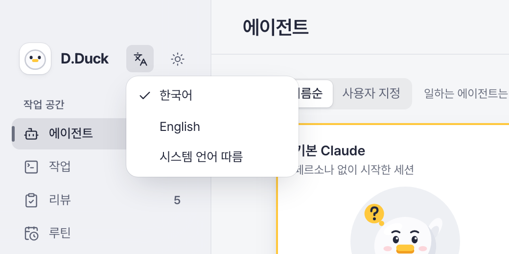
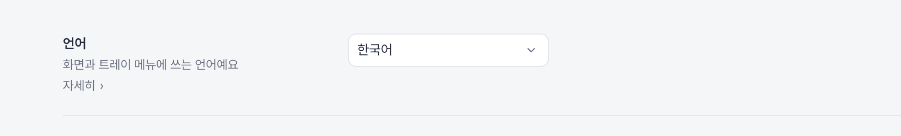
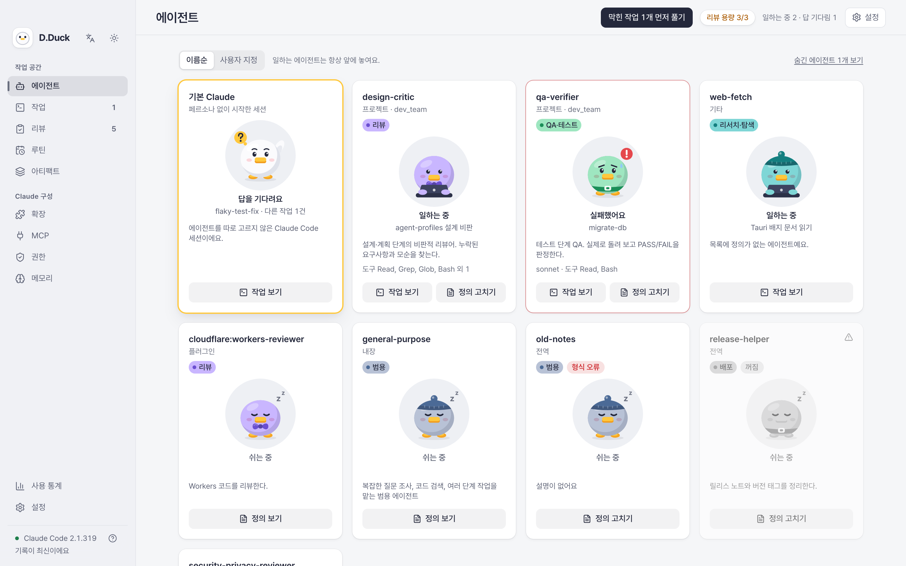

<!-- markdownlint-disable MD033 MD041 -->
<div align="center">


# D.Duck

**세션이 아니라, 팀을 여십시오.**

Claude Code를 테크 리드처럼 쓰는 로컬 macOS 앱입니다.
역할별 에이전트에게 일을 맡기고, 막힌 곳을 한눈에 확인하고, 결과를 근거와 함께 리뷰합니다.

[English](README.md) · [설치](#설치) · [소스로 빌드](#소스로-빌드)


</div>

---

## 만든 이유

에이전트 팀에 작업을 맡기면서 권한 통제와 리뷰 공수를 줄이려고 약 일주일간 기능을 설계해 만든 데스크톱 앱입니다. 로컬 Claude Code 사용 중심으로 개발했습니다.
Claude Code는 강력하지만 세션을 여러 개 돌리면 상태와 설정이 흩어집니다.

- 세션 상태, 토큰 비용, 사용한 스킬과 도구가 터미널과 세션마다 따로 있습니다.
- 권한, 메모리, 플러그인, 스킬이 여러 파일에 나뉘어 실제 적용 내용을 알기 어렵습니다.
- 백그라운드 작업이 쌓이면 막힌 작업과 리뷰할 작업을 놓치기 쉽습니다.
- 기존 도구는 통계나 세션 하나만 보여줍니다. 맡기기, 확인하기, 설정하기를 잇지 못합니다.

### 왜 오리인가

D.Duck은 **Developer Duck**의 줄임말입니다. [러버덕 디버깅](https://ko.wikipedia.org/wiki/러버덕_디버깅)에서 착안했습니다. 고무 오리에게 문제를 설명하다 보면 답이 보이듯, 에이전트 오리들에게 일을 설명하고 맡깁니다. 다만 이 오리들은 대답합니다.

## 아이디어: Claude를 테크 리드처럼

코드를 한 줄씩 읽지 않습니다. 막힌 것과 리뷰가 필요한 것에 집중합니다.

```text
 1. 맡기기              2. 역할별 실행             3. 막힌 작업 먼저 풀기      4. 새로운 눈으로 검증
 ─────────────────  →   ─────────────────────  →   ──────────────────────  →   ─────────────────────
 목표, 범위 밖,         작업 유형마다 역할,        내 답을 기다리거나          끝난 작업은 원래
 제약, 완료 기준을      도구, 기본 권한,           실패한 작업이 맨 위로       대화를 본 적 없는
 구조화한 브리프로      생각 깊이가 따릅니다.      올라옵니다. 사이드바        새 QA·리뷰 세션에
 넘깁니다.              개발 작업은 자기           배지와 '막힌 작업           보냅니다. 코드를 쓴
                        작업 공간(worktree)        먼저 풀기' 이동이           세션은 최악의
                        에서 실행됩니다.           있습니다.                   리뷰어입니다.
```

세 가지가 이를 받칩니다.

- **팀 규칙.** 모든 작업에 같은 규칙이 붙습니다. 범위 밖 수정 금지, 추측 대신 "Blocked:"로 중단, 기본 브랜치 커밋 금지, 배포·결제·삭제 명령 직전 확인 등입니다. 안전 규칙은 잠겨 있고 나머지는 앱에서 고칠 수 있습니다.
- **리뷰 용량.** 하루에 제대로 리뷰할 수 있는 변경 수를 정합니다(기본 3개). 초과하면 새 작업 시작 전에 D.Duck이 한 번 더 확인합니다. 병목은 세션 수가 아니라 리드의 리뷰 시간입니다.
- **역할 오리.** 기본 역할은 열 가지입니다. 개발, QA, 리뷰, 보안, 배포, 리서치, 문서, 학습, 디자인, 설계. 작업 세션에만 주입되므로 설정 파일은 그대로입니다. 기존 에이전트 정의가 있으면 그대로 사용합니다.

## 할 수 있는 일

| 영역 | 하는 일 |
|---|---|
| **에이전트** | 모든 에이전트(사용자, 프로젝트, 플러그인, 내장)를 오리 카드로 표시합니다. 작업 중, 내 답 대기, 실패, 휴식 상태를 보여주고 "막힌 작업 먼저 풀기"로 막힌 곳에 바로 이동합니다. |
| **작업 맡기기** | 폴더와 10가지 작업 유형 중 하나를 고릅니다. 시작 전에 Claude가 되묻고 브리프를 다시 써 줍니다. 전달될 지시문을 미리 볼 수 있습니다. |
| **작업 보드** | 대기 → 진행 중 → 확인 필요 → 리뷰 대기 → 마무리. 터미널 세션과 D.Duck 작업을 한 보드에서 보고, 터미널 실시간 미리보기와 답변 필요 알림을 제공합니다. |
| **리뷰** | 작업마다 보고서를 남깁니다. 완료 기준별 충족·부분 충족·미충족, 묻지 않고 내린 결정, 스크린샷·테스트 리포트·명령 등의 근거를 담습니다. 리뷰 탭은 끝난 작업을 역할별로 묶어 보여줍니다. |
| **가드레일** | 맡긴 작업이 어디서 멈추고 사람을 기다릴지 정합니다. 기본 가드레일은 초안 PR입니다. 에이전트는 작업 브랜치 push와 초안 PR까지만 하고 머지는 하지 못합니다. 신뢰가 중요한 저장소는 "원격 push 막기"으로 가드레일을 내 컴퓨터 안으로 옮깁니다. 로컬에서 리뷰하기 전에는 아무것도 밖으로 나가지 않습니다. 엄격한 작업 유형(보안, 배포, QA)은 위험한 권한 모드를 고를 수 없습니다. |
| **루틴과 아티팩트** | 로컬 또는 claude.ai 클라우드 루틴으로 일정에 맞춰 작업을 실행합니다. 세션 곳곳에서 Claude가 만든 아티팩트를 한곳에서 찾습니다. |
| **JSON 없이 설정** | 스킬, 명령, 워크플로, 플러그인, MCP 서버, 규칙, 메모리, 위험도가 붙은 실효 권한을 앱에서 만들고, 고치고, 지웁니다. 저장 전에 변경 내용을 먼저 보여줍니다. |
| **사용량** | 기간별 비용, 모델, 도구·스킬 호출, 세션 흐름, 사용량 한도 알림을 제공합니다. 비용 절감과 성공률 향상 방안을 찾는 사용량 리뷰도 있습니다. |

<table>
<tr>
<td width="50%"></td>
<td width="25%"></td>
<td width="25%"></td>
</tr>
<tr>
<td align="center">원격 push 막기로 프로젝트를 로컬에 두기</td>
<td align="center">사이드바에서 언어 바꾸기</td>
<td align="center">설정에서도 골라요</td>
</tr>
</table>

<table>
<tr>
<td></td>
<td></td>
</tr>
<tr>
<td align="center">지금 일하는 에이전트</td>
<td align="center">시작 전에 Claude가 되묻기</td>
</tr>
<tr>
<td></td>
<td></td>
</tr>
<tr>
<td align="center">근거가 담긴 보고서</td>
<td align="center">끝난 작업을 역할별로 묶음</td>
</tr>
</table>


## 설계 원칙

| | |
|---|---|
| **로컬 전용** | Claude Code 기록은 이 Mac에서만 읽고, 앱 데이터는 로컬 데이터베이스에 둡니다. 외부 요청은 링크 설치, 사용량 리뷰처럼 직접 시작한 경우뿐입니다. |
| **자격증명 접근 없음** | Claude 로그인 정보를 읽거나 저장하거나 전송하지 않습니다. 이미 로그인된 공식 Claude CLI만 호출합니다. |
| **transcript 원문 저장 없음** | transcript는 숫자와 이름으로 집계만 하고 저장하지 않습니다. 원문 보기는 열 때만 읽고, 비밀 값은 기본으로 가립니다. |
| **위험한 동작은 확인** | 설정 파일 쓰기, 위험한 권한, 루틴 승인, 설치는 되돌리기 어렵습니다. 변경 내용을 보여주고 먼저 확인합니다. |

이 가드레일은 프롬프트 부탁에 그치지 않고 CLI deny 규칙, 훅, git 환경 설정으로 강제합니다. 핵심은 에이전트가 혼자 해도 되는 일과 사람이 봐야 하는 일 사이에 고정된 선을 긋는 것입니다. 알려진 빈틈은 [`docs/DECISIONS-SUMMARY.md`](docs/DECISIONS-SUMMARY.md#task-execution-and-safety-rails)(D-142, D-143)에 정리했습니다.

## 설치

> **상태: 초기 버전(v0.1.0).** Apple Silicon Mac만 지원합니다. UI는 한국어와 영어를 지원합니다. 사이드바나 설정에서 바꿉니다. 앱은 ad-hoc 서명이고 공증(notarize)은 받지 않았습니다.

1. [Releases](https://github.com/DevJoyKo/d-duck/releases)에서 최신 `.dmg`를 받아 **D.Duck**을 Applications로 끌어다 놓습니다.
2. 첫 실행 시 macOS가 개발자를 확인할 수 없다고 표시합니다. **시스템 설정 → 개인정보 보호 및 보안**에서 **무시하고 열기**를 누르거나 아래 명령을 실행합니다.

   ```bash
   xattr -dr com.apple.quarantine /Applications/D.Duck.app
   ```

3. [Claude Code](https://docs.claude.com/en/docs/claude-code)가 설치되어 있어야 합니다. 로그인하지 않았다면 D.Duck이 브라우저 로그인 버튼을 표시합니다.

## 소스로 빌드

필요 환경: Rust 1.85+, Node 22+, Xcode Command Line Tools.

```bash
git clone https://github.com/DevJoyKo/d-duck.git
cd d-duck/app
npm install
npm run tauri dev          # run the app in dev mode
npm run dev:mock           # UI only, with sample data, at http://localhost:1430
```

```bash
cargo test -p dduck-core   # Rust core tests
npx vitest run             # UI tests
npm run lint
npm run tauri build        # release build (scripts/release-local.sh for a signed local DMG)
```

## 프로젝트 구조

| 경로 | 내용 |
|---|---|
| `app/crates/dduck-core` | 수집, SQLite, 분석, Claude CLI 연동 (Rust, Tauri 의존성 없음) |
| `app/src-tauri` | Tauri 2 셸: 창, 트레이, IPC 명령, 알림, 대화상자 |
| `app/src` | React 19 + Vite + TypeScript + Tailwind UI |
| `openspec/` | 기능마다 하나씩 쌓은 스펙, 그리고 모든 결정의 기록 |
| `docs/features` | ID가 붙은 기능 목록, 자동화 테스트와 연결된 테스트 케이스 |

D.Duck은 앱이 권하는 방식대로 만들었습니다. 모든 기능은 [OpenSpec](https://github.com/Fission-AI/OpenSpec) change로 시작하며, 설계 단계와 출시 전에 리뷰 에이전트 두 개 이상이 점검합니다.

## 로드맵

- 리뷰 화면에서 바로 재작업 요청
- 공증 빌드, 그리고 Intel, Linux, Windows 지원

## 기여하기

이슈와 풀 리퀘스트를 환영합니다. 개발 환경, 스펙 주도 절차, 리뷰 기준은 [CONTRIBUTING.md](CONTRIBUTING.md)(영문)에 있습니다. [행동 강령](CODE_OF_CONDUCT.md)을 지켜 주시고, 보안 문제는 공개 이슈 대신 [SECURITY.md](SECURITY.md)의 비공개 제보 방법으로 알려 주십시오.

## 라이선스

[Apache License 2.0](LICENSE). 서드파티 구성 요소는 [app/THIRD_PARTY.md](app/THIRD_PARTY.md)를 참고하십시오.

---

<sub>D.Duck은 독립 프로젝트입니다. Anthropic과 제휴하거나 보증받은 프로젝트가 아닙니다. Claude와 Claude Code는 Anthropic의 상표입니다.</sub>
