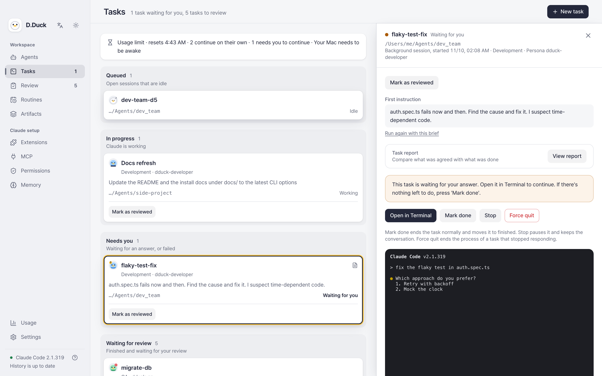
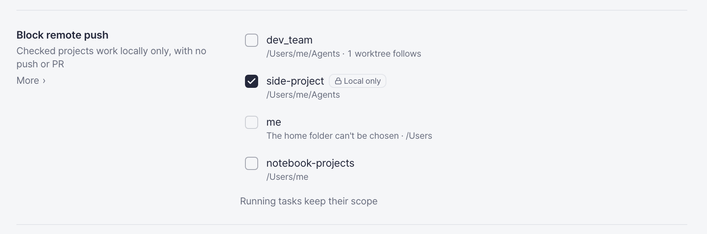
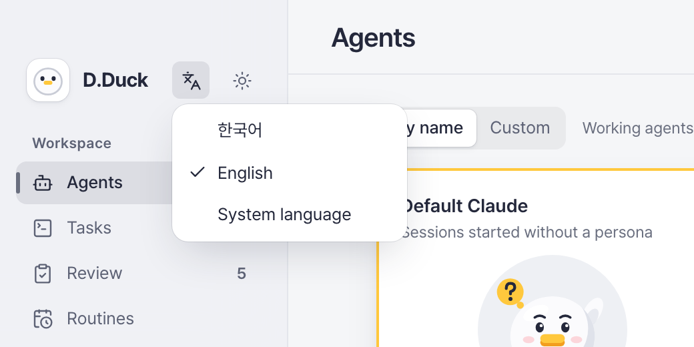
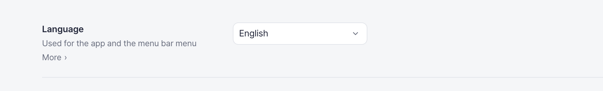
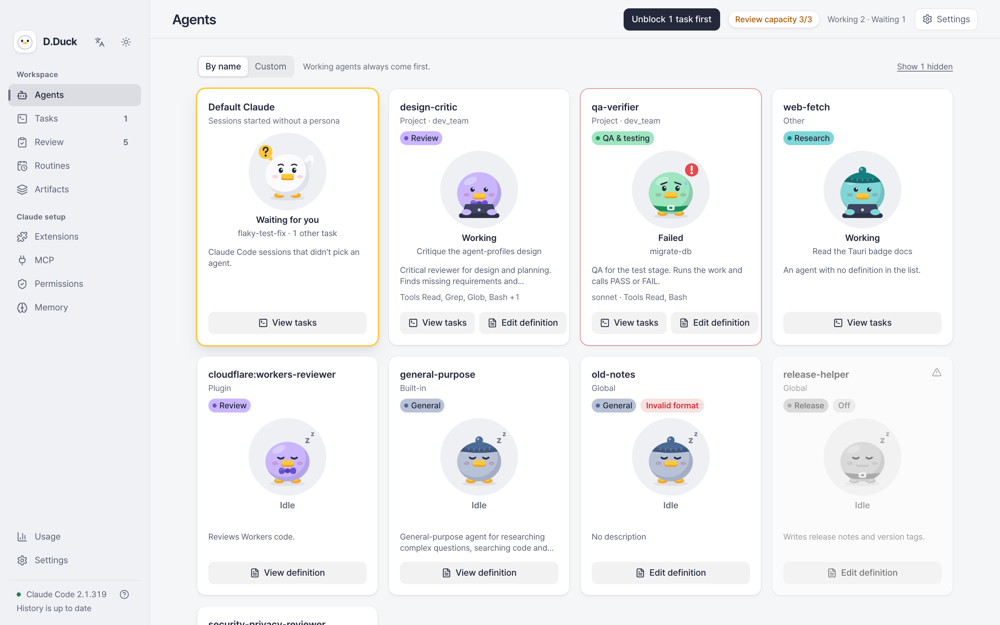
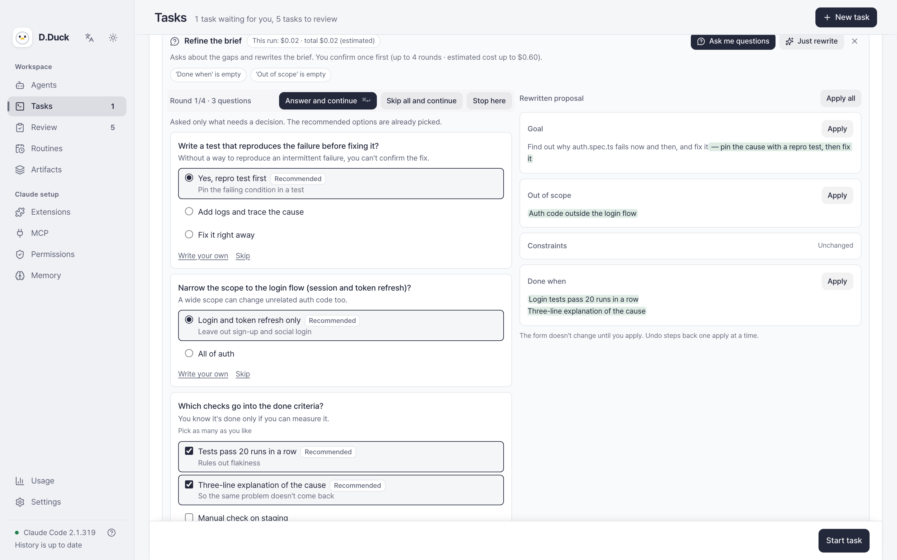
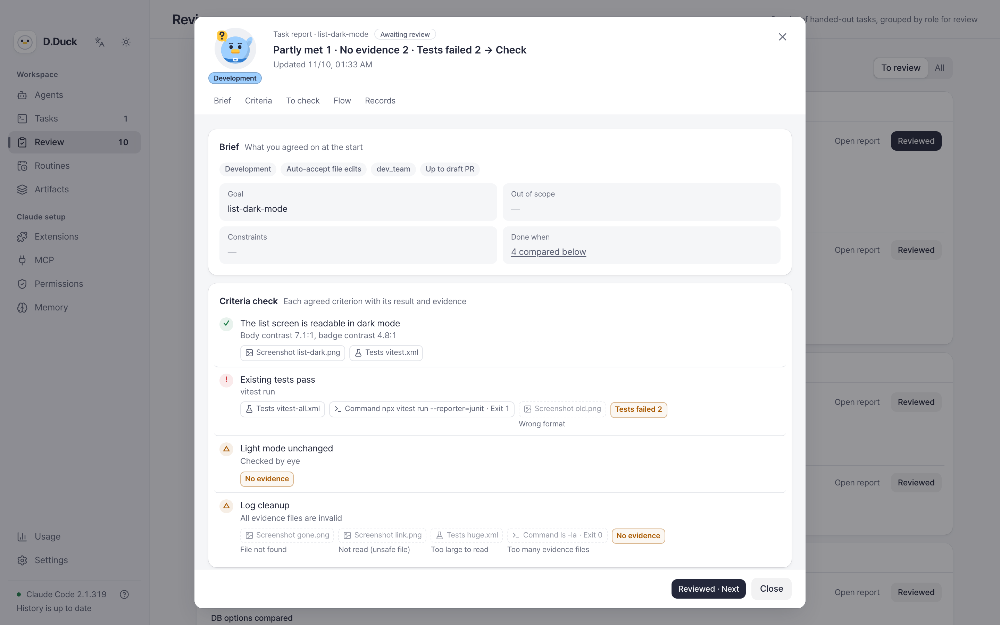
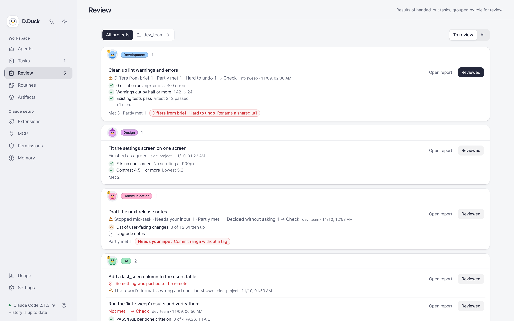

<!-- markdownlint-disable MD033 MD041 -->
<div align="center">


# D.Duck

**Open a team, not a session.**

A local macOS app for running Claude Code like a tech lead:
hand off work to role-based agents, see what's blocked, and review results with evidence.

[한국어](README.ko.md) · [Install](#install) · [Build from source](#build-from-source)



</div>

---

## Why I built this

I wanted to hand real work to a team of Claude Code agents without giving up control over permissions, and without spending all the time I saved on reviewing their output. D.Duck came out of about a week of thinking that through and building it. It's centered on running Claude Code locally.

Claude Code is powerful, but once you run several sessions at once, state and settings scatter:

- Session status, token cost, and which skills and tools were used live in separate terminals and sessions.
- Permissions, memory, plugins, and skills are split across several files, so it's hard to tell what actually applies.
- As background tasks pile up, it's easy to miss what's blocked and what needs review.
- Existing tools show stats or a single session. They don't connect handing off, checking, and configuring.

### Why a duck?

D.Duck stands for **Developer Duck**, from [rubber duck debugging](https://en.wikipedia.org/wiki/Rubber_duck_debugging): you explain the problem to a duck, and the explaining helps. Here the ducks are your agents, and they answer back.

## The idea: run Claude like a tech lead

You don't read every line of code. You focus on what's blocked and what needs review.

```text
 1. Hand off          2. Run by role         3. Unblock first        4. Verify with fresh eyes
 ───────────────  →   ───────────────   →    ───────────────    →    ─────────────────────────
 A structured         Each task type         Tasks waiting on        Send finished work to a
 brief: goal, out     brings its role,       you or failed rise      new QA or review session
 of scope,            tools, default         to the top, with a      that never saw the original
 constraints,         permissions, and       sidebar badge and an    conversation. The session
 done criteria.       effort. Dev work       "Unblock first" jump.   that wrote the code is its
                      runs in its own                                worst reviewer.
                      worktree.
```

Three things hold it together:

- **Team rules.** The same rules are added to every task. For example: don't touch what's out of scope, stop with "Blocked:" instead of guessing, never commit to the default branch, ask right before deploy, payment, or delete commands. Safety rules are locked. You can edit the rest in the app.
- **Review capacity.** You set how many changes you can properly review in a day (3 by default). Past that, D.Duck asks once more before starting new work, because the bottleneck is the lead's review time, not the number of sessions.
- **Role ducks.** Ten built-in roles: dev, QA, review, security, release, research, writing, tutor, design, and architecture. They're injected into task sessions only, so your own settings files stay untouched. If you already have your own agent definitions, D.Duck uses them as they are.

## What you can do

| Area | What it does |
|---|---|
| **Agents** | See every agent (user, project, plugin, built-in) as a duck card that shows whether it's working, waiting for you, failed, or idle. Use "Unblock first" to jump to what's stuck. |
| **Hand off a task** | Pick a folder and one of 10 task types. Claude asks clarifying questions and rewrites the brief before it starts. Preview the exact instructions it will receive. |
| **Task board** | Waiting → working → needs attention → to review → wrap-up. Terminal sessions and D.Duck tasks are on the same board, with a live terminal preview and a notification when a task needs your answer. |
| **Review** | Every task leaves a report: each done criterion as met, partly met, or not met, the decisions made without asking, and evidence such as screenshots, test reports, and commands. The Review tab groups finished work by role. |
| **Guardrails** | Decide where delegated work must stop and wait for you. By default the guardrail sits at a draft PR: agents can push a work branch and open a draft, but never merge. For trust-critical repos, move the guardrail onto your machine with "Block remote push": nothing leaves until you have reviewed it locally. Strict task types (security, deploy, QA) can't pick risky permission modes. |
| **Routines and artifacts** | Run work on a schedule, locally or as claude.ai cloud routines. Find the artifacts Claude made across sessions. |
| **Configure without JSON** | Skills, commands, workflows, plugins, MCP servers, rules, memory, and effective permissions with their risk levels. Create, edit, and delete them in the app. Changes are shown before they're saved. |
| **Usage** | Cost, models, and tool and skill calls by period, session flows, usage-limit alerts, and a usage review that finds ways to cut cost and raise success rates. |

<table>
<tr>
<td width="50%"></td>
<td width="25%"></td>
<td width="25%"></td>
</tr>
<tr>
<td align="center">Block remote push keeps a project local</td>
<td align="center">Switch language from the sidebar</td>
<td align="center">Or pick it in Settings</td>
</tr>
</table>

<table>
<tr>
<td></td>
<td></td>
</tr>
<tr>
<td align="center">Who's working right now</td>
<td align="center">Claude asks before it starts</td>
</tr>
<tr>
<td></td>
<td></td>
</tr>
<tr>
<td align="center">A report with evidence</td>
<td align="center">Finished work, grouped by role</td>
</tr>
</table>


## Design principles

| | |
|---|---|
| **Local only** | Claude Code records are read on this Mac only, and app data stays in a local database. The only outside requests are ones you trigger yourself, such as installing from a link or running a usage review. |
| **No access to credentials** | D.Duck never reads, stores, or sends your Claude login. It only calls the official Claude CLI you've already logged in to. |
| **No raw transcripts** | Transcripts are aggregated into numbers and names, not stored. The raw view reads them only when you open it, with secrets masked by default. |
| **Confirm risky actions** | Writing settings files, risky permissions, approving routines, and installs are hard to undo. D.Duck shows what will change and asks first. |

These guardrails are enforced through CLI deny rules, a hook, and git environment settings, not just asked for in a prompt. The point is a fixed line between what an agent may do on its own and what needs a person. The known gaps are summarized in [`docs/DECISIONS-SUMMARY.md`](docs/DECISIONS-SUMMARY.md#task-execution-and-safety-rails) (D-142, D-143).

## Install

> **Status: early (v0.1.0).** Apple Silicon Macs only for now. The UI comes in Korean and English. Switch it from the sidebar or in Settings. The app is ad-hoc signed, not notarized.

1. Download the latest `.dmg` from [Releases](https://github.com/DevJoyKo/d-duck/releases) and drag **D.Duck** into Applications.
2. On first launch, macOS says it can't verify the developer. Open **System Settings → Privacy & Security** and click **Open Anyway**, or run:

   ```bash
   xattr -dr com.apple.quarantine /Applications/D.Duck.app
   ```

3. You need [Claude Code](https://docs.claude.com/en/docs/claude-code) installed. If you're not logged in, D.Duck shows a button that opens the browser login.

## Build from source

Requirements: Rust 1.85+, Node 22+, Xcode Command Line Tools.

```bash
git clone https://github.com/DevJoyKo/d-duck.git
cd d-duck/app
npm install
npm run tauri dev          # run the app in dev mode
npm run dev:mock           # UI only, with sample data, at http://localhost:1430
```

```bash
cargo test -p dduck-core   # Rust core tests
npx vitest run             # UI tests
npm run lint
npm run tauri build        # release build (scripts/release-local.sh for a signed local DMG)
```

## Project layout

| Path | What's there |
|---|---|
| `app/crates/dduck-core` | Ingest, SQLite, analytics, Claude CLI integration (Rust, no Tauri dependency) |
| `app/src-tauri` | Tauri 2 shell: window, tray, IPC commands, notifications, dialogs |
| `app/src` | React 19 + Vite + TypeScript + Tailwind UI |
| `openspec/` | A spec for every feature, one change at a time, and a log of every decision |
| `docs/features` | Feature list with IDs and test cases mapped to automated tests |

D.Duck was itself built the way it asks you to work. Every feature starts as an [OpenSpec](https://github.com/Fission-AI/OpenSpec) change, and at least two review agents check it at design time and again before it ships.

## Roadmap

- Rework requests straight from the review screen
- Notarized builds, plus Intel, Linux, and Windows

## Contributing

Issues and pull requests are welcome. Start with [CONTRIBUTING.md](CONTRIBUTING.md) for setup, the spec-driven workflow, and review rules. Please follow the [Code of Conduct](CODE_OF_CONDUCT.md), and report security problems privately as described in [SECURITY.md](SECURITY.md).

## License

[Apache License 2.0](LICENSE). Third-party components are listed in [app/THIRD_PARTY.md](app/THIRD_PARTY.md).

---

<sub>D.Duck is an independent project. It is not affiliated with or endorsed by Anthropic. Claude and Claude Code are trademarks of Anthropic.</sub>
