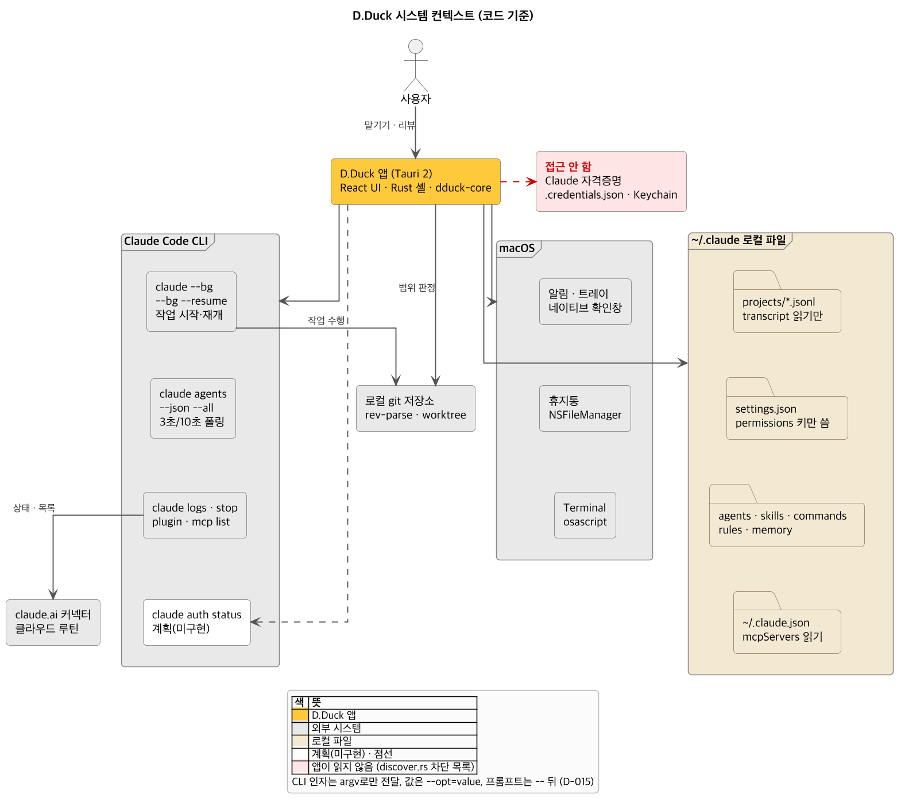
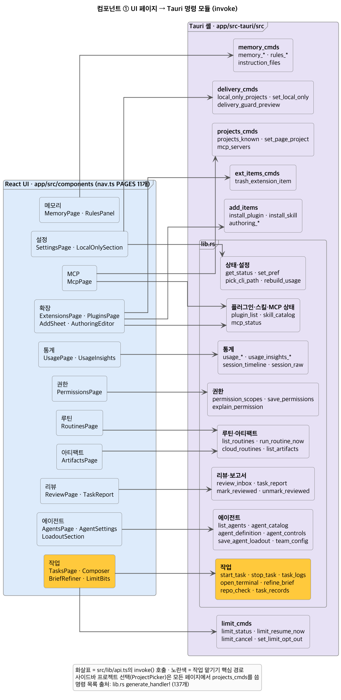
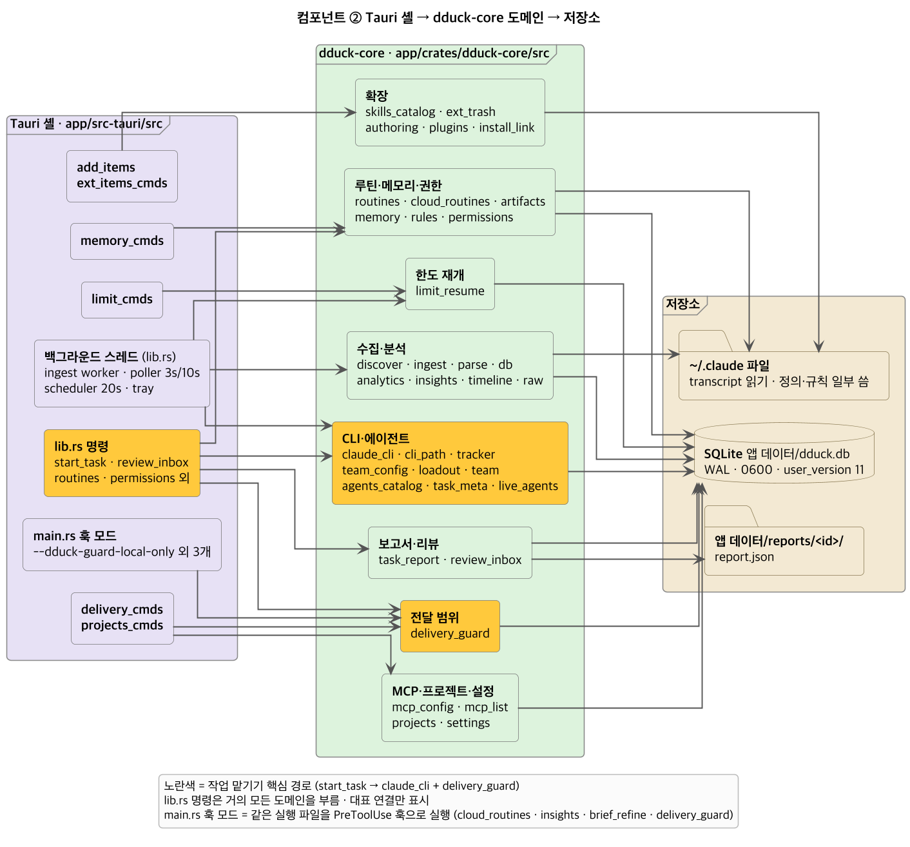
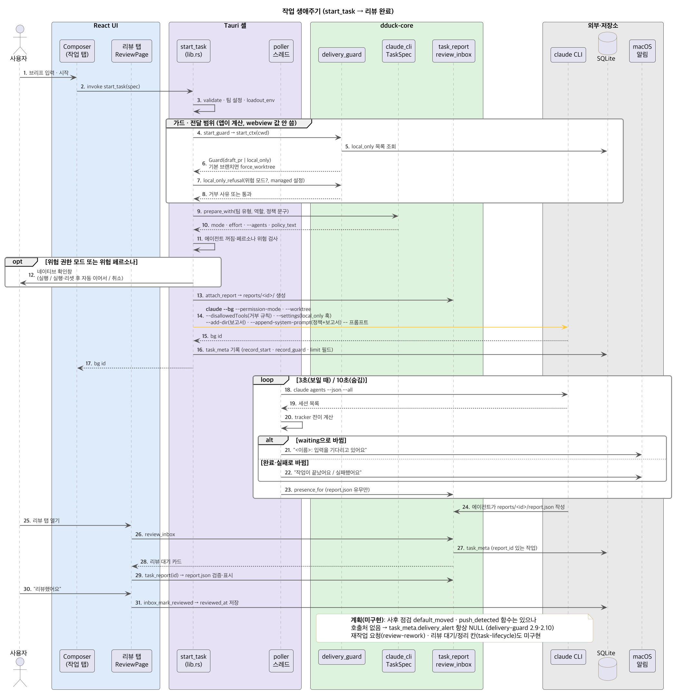
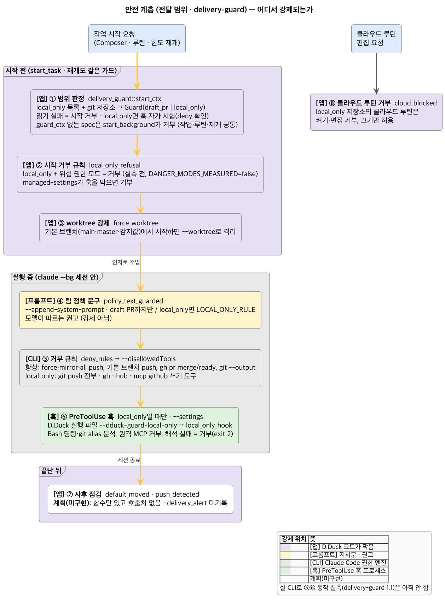
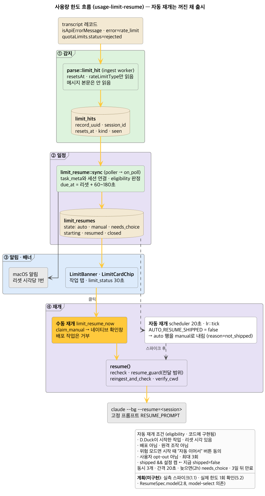
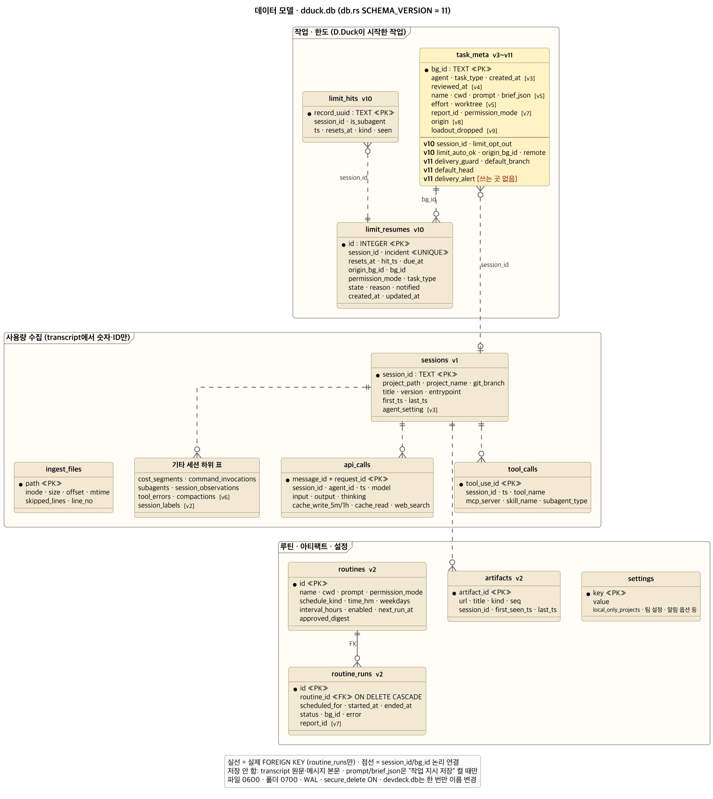

# D.Duck 구현 설계 문서 (코드 기준)

- 지금 코드에 있는 구현을 그림으로 정리합니다. OpenSpec 계획(`openspec/changes/*`)은 참고만 했습니다.
- 계획과 코드가 다르면 코드를 따릅니다. 코드에 없는 항목은 그림에 **계획(미구현)** 으로 표시합니다(흰 바탕, 점선).
- 기준 시점: 2026-11-09 작업 트리. `db.rs SCHEMA_VERSION = 11`, `generate_handler!` 명령 137개입니다.
- 색 규칙: UI 연파랑 · 셸 라벤더 · 코어 연초록 · 외부 회색 · 저장소 베이지 · 핵심 경로만 노랑(`#ffc83d`).

## 다시 그리기

```bash
cd docs/design/diagrams
plantuml -tpng [0-9]*.puml   # 공통 스타일은 _style.iuml (dpi 150, linetype ortho)
```

---

## 1. 시스템 컨텍스트



- 앱은 `claude` CLI를 argv로만 부릅니다: `--bg`, `--bg --resume`, `agents --json --all`, `logs`, `stop`, `plugin`, `mcp list`.
- `~/.claude`의 transcript는 읽기만 합니다. `settings.json`은 `permissions` 키만 씁니다.
- macOS 연동은 알림·트레이·네이티브 확인창, 휴지통(NSFileManager), Terminal(osascript)입니다.
- claude.ai 커넥터·클라우드 루틴은 CLI를 거쳐 상태와 목록만 봅니다.
- 자격증명(`.credentials.json`, Keychain)에는 접근하지 않습니다. `discover.rs`가 이름 패턴으로 막습니다.

**확인할 것**
- `claude auth status`는 계획(claude-login, 19개 태스크 미완)입니다. 코드에 호출이 없습니다.
- git은 앱이 범위 판정용으로 직접 읽고(`delivery_guard::app_git`), 실제 작업은 CLI 세션이 합니다.

## 2. 컴포넌트

### 2-1. UI 페이지 → Tauri 명령 모듈



- 페이지 11개는 `nav.ts PAGES` 순서와 같습니다(에이전트 … 설정).
- 명령 대부분은 `src-tauri/src/lib.rs`(3,500줄)에 있습니다. 그림은 도메인별로 묶었습니다.
- 별도 모듈: `limit_cmds`, `delivery_cmds`, `add_items`, `ext_items_cmds`, `projects_cmds`, `memory_cmds`.

### 2-2. 셸 → dduck-core 도메인 → 저장소



- 백그라운드 스레드 3개: ingest worker(파일 감시 + 30초 재스캔), poller(3초/숨김 10초), scheduler(20초).
- `main.rs`는 같은 실행 파일을 PreToolUse 훅으로도 띄웁니다. 플래그 4개: 클라우드 루틴·인사이트·다듬기·로컬만.
- 저장소는 셋입니다: SQLite `dduck.db`, 앱 데이터 `reports/<id>/report.json`, `~/.claude` 파일.

**확인할 것**
- `dduck-core`는 Tauri에 의존하지 않습니다(`lib.rs` 주석: 나중에 헤드리스 데몬에서 재사용).
- 그림의 lib.rs → 코어 연결은 대표 연결입니다. lib.rs는 거의 모든 도메인을 부릅니다.

## 3. 작업 생애주기



- 시작 순서: `validate` → 전달 범위(`start_guard`) → `local_only_refusal` → `prepare_with` → 위험 검사·확인창 → `attach_report` → `claude --bg`.
- 인자: `--permission-mode`는 항상 명시합니다. 거부 규칙은 `--disallowedTools`, 훅은 `--settings`, 정책·보고서 지시는 `--append-system-prompt`로 넘깁니다.
- 시작 뒤 `task_meta`에 기록합니다. 프롬프트·브리프는 "작업 지시 저장"이 켜져 있을 때만 저장합니다.
- poller가 상태 전이를 계산합니다. waiting이면 "입력을 기다리고 있어요", 끝나면 완료/실패 알림을 띄웁니다.
- 리뷰 탭은 `report_id`가 있는 작업을 보여 줍니다. "리뷰했어요"는 `reviewed_at`을 저장합니다.

**확인할 것**
- 신뢰하지 않은 폴더면 `trust_then_retry`가 Terminal을 열고 기다린 뒤 다시 시작합니다.
- 계획(미구현): 사후 점검과 보고서 경고 칩(delivery-guard 2.9·2.10·4.4), 재작업 요청(review-rework), 리뷰 대기/정리 칸(task-lifecycle), 근거가 붙은 보고서 v2(report-evidence). 지금 보고서는 `version: 1`만 받습니다.

## 4. 안전 계층



| 계층 | 강제 위치 | 코드 |
|---|---|---|
| ① 범위 판정 | 앱 | `delivery_guard::start_ctx` · 읽기 실패 = 시작 거부 |
| ② 시작 거부 | 앱 | `local_only_refusal` · local_only + 위험 모드, managed 훅 차단 |
| ③ worktree 강제 | 앱 → CLI | `force_worktree` · 기본 브랜치에서 시작할 때 |
| ④ 팀 정책 문구 | 프롬프트 | `policy_text_guarded` · 권고일 뿐 강제는 아님 |
| ⑤ 거부 규칙 | CLI | `deny_rules` → `--disallowedTools` |
| ⑥ PreToolUse 훅 | 훅 | `local_only_hook` · local_only일 때만, 해석 실패 = 거부 |
| ⑦ 사후 점검 | 앱 | **계획(미구현)** · `default_moved`·`push_detected` 호출처 없음 |
| ⑧ 클라우드 루틴 거부 | 앱 | `cloud_blocked` · 켜기·편집 거부, 끄기만 허용 |

**확인할 것**
- 작업·루틴·한도 재개 모두 `guard_ctx`가 없으면 `start_background`가 거부합니다(기본값으로 넘어가지 않음).
- ⑤⑥을 실제 CLI로 재 본 실측(delivery-guard 1.1)은 아직 하지 않았습니다. 그래서 `DANGER_MODES_MEASURED = false`이고, local_only에서 위험 모드를 거부합니다.

## 5. 사용량 한도 흐름



- 감지: `parse::limit_hit`이 `quotaLimits.resetsAt`·`rateLimitType`만 읽어 `limit_hits`에 넣습니다. 메시지 본문은 읽지 않습니다.
- 일정: poller의 `limit_resume::sync`가 `limit_resumes` 행을 만들고 `due_at`(리셋 + 60~180초)을 정합니다.
- 알림: 리셋 시각당 한 번 띄웁니다. 작업 탭 `LimitBanner`가 30초마다 `limit_status`를 봅니다.
- 재개: 지금은 수동만 됩니다. `limit_resume_now` → 확인창 → `claude --bg --resume=<session>` + 고정 프롬프트.

**확인할 것**
- 자동 재개 코드(`tick`, `eligibility`)는 있지만 `AUTO_RESUME_SHIPPED = false`입니다. scheduler가 auto 행을 manual(`not_shipped`)로 내립니다.
- 계획(미구현): 실측 스파이크(1.1), 실제 한도 1회 확인(5.2), 재개 때 모델 고정(2.8, model-select 의존).

## 6. 데이터 모델



- 표 18개, 마이그레이션 v1~v11. 실제 FOREIGN KEY는 `routine_runs.routine_id` 하나이고, 나머지는 `session_id`/`bg_id` 논리 연결입니다.
- v10: `limit_hits`·`limit_resumes` 표, `task_meta`에 `session_id`·`limit_opt_out`·`limit_auto_ok`·`origin_bg_id`·`remote`가 생겼습니다.
- v11: `task_meta`에 `delivery_guard`·`default_branch`·`default_head`·`delivery_alert`가 생겼습니다.

**확인할 것**
- `delivery_alert`는 열만 있고 쓰는 코드가 없습니다(사후 점검 미구현).
- DB 파일은 0600, 폴더는 0700, `secure_delete = ON`입니다. 옛 `devdeck.db`는 한 번만 이름을 바꿉니다.

---

## 구현 상태

기준: 코드에 동작 경로가 있으면 "구현", 일부만 있으면 "부분", 코드에 없으면 "계획"입니다. 괄호는 OpenSpec change 이름입니다.

| 기능 | 구현 | 부분 구현 | 계획 |
|---|:-:|:-:|:-:|
| transcript 증분 수집 · 통계 탭 | ● | | |
| 사용 인사이트 · 요구사항 다듬기 (usage-insights, brief-grilling) | ● | | |
| 작업 맡기기 · 팀 유형 · 역할 장비 (team-presets-editable, agent-loadout) | ● | | |
| 위험 모드 · 페르소나 네이티브 확인 | ● | | |
| 작업 보고서 report.json v1 (decision-report) | ● | | |
| 리뷰 탭 · 리뷰했어요 · 되돌리기 (review-inbox) | ● | | |
| 전달 범위 가드 (delivery-guard) | | ● 시작 전 가드·거부 규칙·훅·worktree·클라우드 거부 / 사후 점검·보고서 경고 없음 | |
| 사용량 한도 감지 · 알림 · 수동 재개 (usage-limit-resume) | ● | | |
| 한도 후 자동 재개 | | ● 코드 있음, `AUTO_RESUME_SHIPPED = false` | |
| 로컬 루틴 · 클라우드 루틴 조회·편집 (artifacts-and-routines, cloud-routine-edit) | ● | | |
| 아티팩트 목록 · 미리보기 (artifact-cards-preview) | ● | | |
| 확장: 스킬·플러그인·링크 설치·작성·휴지통 | ● | | |
| MCP 탭 · 권한 탭 · 메모리·규칙 탭 | ● | | |
| 프로젝트 전환 · 휴대폰 원격 조작(`--remote-control`) | ● | | |
| 근거 붙은 보고서 v2 (report-evidence) | | | ● |
| 작업 보드 리뷰 대기·정리 칸 (task-lifecycle) | | | ● |
| 재작업 요청 (review-rework) | | | ● |
| Claude 로그인 상태 확인 (claude-login) | | | ● |
| 에이전트·작업별 모델 선택 (model-select) | | | ● 내부 실행만 `--model` 고정(haiku·sonnet) |
| 휴대폰 보기 서버 (mobile-companion) | | | ● |

- "구현"이어도 OpenSpec 태스크의 실앱 확인·리뷰 항목이 남은 change가 있습니다(artifacts-and-routines 3.1·4b.3·5.1 등).
